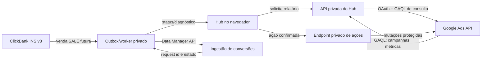

# Integração Google Ads ↔ Hub: pesquisa, MVP e visão de evolução

**Fontes oficiais revalidadas em:** 07/11/2026; estado do código atualizado em 07/11/2026  
**Escopo:** possibilidades de integrar a Google Ads API e a Data Manager API ao Hub local, com dados de vendas ClickBank INS v8. Este documento orienta decisões; não representa autorização para conectar uma conta, enviar conversões, alterar campanhas ou publicar arquivos.

## Adendo de estado — 07/11/2026

O histórico abaixo registra o estado e a pesquisa de 06/11; suas frases sobre ausência de emissor GuruMedia estão superadas pelo código local atualizado em 07/11. O serviço privado GuruMedia agora tem integração Data Manager com rotas por MCC, fila/outbox idempotente, `validateOnly`, envio manual e envio automático opcional (desligado por padrão). O worker/Cron existente processa envios e diagnósticos. A interface do Hub sincroniza rotas, mostra status por venda e oferece validação e envio manual.

O usuário informou que a versão inicial do serviço e o worker foram publicados e que o SQL foi executado; essa publicação não foi verificada diretamente no servidor. Nenhuma conversão real foi enviada ao Google e a seleção/sincronização das rotas não inicia envio. A validação autorizada de 07/11 e a correção local pendente de publicar estão registradas a seguir. Para uma operação real: publicar o PHP corrigido, validar a venda elegível sem envio, revisar o resultado e confirmar que integração externa ou outro integrador não duplicará o evento antes de qualquer envio manual. Ativação automática exige decisão posterior e fica desligada por padrão.

### Verificação `validateOnly` e correção de identificadores — 07/11/2026

O usuário autorizou validar a venda real já registrada. A tela apresentou “o clique tem mais de um identificador Google; o envio foi bloqueado por segurança”. A verificação do serviço mostrou que a rejeição ocorria antes da chamada à Data Manager API: o código local exigia exatamente um tipo de identificador. Portanto, essa resposta não é um erro da API e não confirma que o Google recebeu a solicitação; nenhuma conversão foi enviada.

A correção local aceita todos os identificadores capturados (`gclid`, `wbraid`, `gbraid`) na mesma conversão, exigindo ao menos um, um único evento de clique Hub e nenhum valor inválido ou conflitante do mesmo tipo. A documentação oficial do Google Ads recomenda enviar todos os identificadores capturados e documenta qualquer combinação, com precedência `gclid`, `wbraid`, `gbraid`. No mapeamento para Data Manager, os campos correspondentes são `ad_identifiers.gclid`, `ad_identifiers.wbraid` e `ad_identifiers.gbraid`. [Google Ads: importação de conversões offline](https://developers.google.com/google-ads/api/docs/conversions/upload-offline), [Data Manager API: mapeamento dos campos](https://developers.google.com/data-manager/api/devguides/events/google-ads/offline/upgrade/field-mappings).

O serviço de origem e sua cópia no pacote de deploy precisam permanecer idênticos. Esta correção altera só `gurumedia-sales-service.php`; não requer SQL, troca do worker/Cron nem alteração de configuração. Até a publicação do PHP corrigido, a versão publicada ainda pode bloquear esse clique. Depois do deploy, repetir **Validar sem enviar**; envio real continua separado e exige autorização explícita.

## Estado anterior confirmado no código e informado pelo usuário (06/11/2026; histórico)

- A integração Google Ads do Hub **não é somente leitura no conjunto**. Há um serviço de consulta/inventário e, separado dele, um endpoint de ações de campanha/recursos. O endpoint de escrita inclui pausa/ativação, criação de campanhas e operações suportadas de alteração de recursos. O backend verifica flags e MCCs permitidas, e as ações da interface incluem prévia/confirmação conforme a operação. O código local não prova quais flags estão ativas na Hostinger; o usuário informou que os deploys foram feitos, mas o arquivo vivo não foi comparado nesta revisão.
- A consulta do inventário de ações por MCC é de leitura. As capturas do usuário mostram uma ação selecionada na MCC e-com e outra na MCC Nutra; o usuário confirmou que estão corretas. A escolha fica no navegador e serve como mapeamento, não como envio de venda.
- O postback GuruMedia registra vendas associadas à Track com comissão, moeda e horário de conversão. O usuário mostrou uma venda de US$ 110 associada à Track/MCC Nutra. Isso prova captura/associação na tela do Hub, não a presença de um `gclid`/`gbraid`/`wbraid` válido nem o envio ao Google Ads.
- Na revisão de 06/11 não havia chamada Data Manager API/`events.ingest` nem emissor GuruMedia. O endpoint de CSV era manual e pertencia ao fluxo ClickBank. Esse fato histórico foi superado pela implementação local de 07/11 descrita no adendo acima.
- A verificação do clique associado e do estado dos emissores continua necessária antes do primeiro envio, mas já existe fluxo local de validação `validateOnly` e controle de fila/outbox.

## Resumo executivo

A integração tem três caminhos que não devem ser confundidos:

1. **Consultar desempenho e estrutura de contas/campanhas:** Google Ads API, por relatórios GAQL. Isso pode trazer ao Hub impressões, cliques, CTR, CPC, conversões, CPA, custo, valores de conversão, palavras-chave e métricas de posição/parcela de impressão, conforme os campos disponíveis para cada recurso.
2. **Enviar eventos ClickBank diretamente:** a ClickBank oferece uma integração oficial Google Ads server-to-server. Ela pode enviar impressões de formulário de pedido e eventos de compra diretamente, sem o Hub operar a API de conversões. Depende de GCLID chegar ao HopLink/Direct Tracking Link e usa permissões Google Ads concedidas à ClickBank.
3. **Enviar vendas controladas pelo Hub:** Data Manager API para novos eventos offline. A documentação atual direciona novas implementações de conversões offline para essa API; o fluxo antigo `UploadClickConversions` da Google Ads API foi descontinuado para novos envios a partir de 15/06/2026.

O Hub já tem uma base própria de Tracking e uma trilha de vendas ClickBank INS v8/CSV definida em documentos do projeto. **A descoberta mais importante da pesquisa aprofundada:** talvez não seja necessário construir envio de conversões no Hub. Primeiro vale comparar a integração nativa da ClickBank e o fluxo atual da integração externa com o valor e a atribuição que o usuário precisa. A peça decisiva em todos os caminhos é provar que a venda está ligada ao identificador Google original; `extclid` do Hub ou ClickBank, sozinho, não o substitui.

**Recomendação mantida:** separar relatórios/inventários, ações de campanha e envio de conversões. Para GuruMedia, usar a validação Data Manager local antes de envio manual, confirmar identificador válido, comissão/moeda/horário e a inexistência de emissor duplicado. A comissão de afiliado continua sendo o valor definido pelo usuário.

## Estado conhecido do projeto

Esta seção sintetiza documentos locais consultados em 26/10/2026, principalmente o contrato INS v8 (18/10), o relatório de GCLID (18/10) e a retomada (22/10). Esses documentos não são uma inspeção ao vivo do Hostinger, da ClickBank ou do Google Cloud.

| Tema | Evidência registrada | Tratamento para trabalho futuro |
|---|---|---|
| Tracking da Pre-Sell | O script captura `page_view` e `outbound_click`, lê parâmetros de URL e cria um ID próprio de clique; para HopLinks, esse ID pode ser enviado como `extclid`. | Manter essa coleta separada de relatórios Ads e eventos ClickBank. |
| ClickBank INS v8 | O modelo próprio preserva transação e itens, deduplica eventos e exclui teste/não-SALE de uma venda elegível. A comissão afiliada é mantida separada do valor bruto pago pelo comprador. | Para a integração futura, usar somente uma venda confirmada e a regra financeira aprovada no contrato. |
| CSV do Hub | O contrato define uma conversão por recibo, valor de comissão `totalAccountAmount`, USD, ID de recibo como ID da transação e GCLID obrigatório para elegibilidade. Exportação atual é manual. | Manter o CSV como contingência; não presumir que já haja upload automático. |
| integração externa | Os registros do projeto diziam que a integração externa continuaria enviando conversões durante a validação paralela. | Não desligar nem substituir a integração externa sem autorização e reconciliação de duplicidade. A configuração ativa precisa ser revalidada antes de qualquer cutover. |
| Publicação do servidor | Notas de outubro indicam deploys e pendências em momentos diferentes. O usuário afirmou posteriormente que todos os deploys foram feitos. | Considerar a declaração do usuário como premissa operacional, sem alegar que houve leitura ao vivo. Reconfirmar somente os componentes estritamente necessários antes da implementação. |
| Integração Google Ads API | O código atual inclui consulta de contas/relatórios/configuração e um serviço de ações de campanha/recursos separado. O usuário reportou deploys feitos; o arquivo vivo não foi inspecionado nesta revisão. | Verificar flags, allowlist MCC e implantação antes de afirmar que uma escrita específica funciona em produção. Não chamar o conjunto de somente leitura. |
| Ações de conversão por MCC | O Hub consulta o inventário e guarda a escolha local por MCC. Capturas fornecidas mostram escolhas para e-com e Nutra, confirmadas pelo usuário. | A seleção identifica um destino potencial; não cria ação, altera meta nem envia venda. |
| Envio GuruMedia → Ads (revisão 06/11) | Não foi encontrado emissor Data Manager nessa revisão histórica. O código local de 07/11 já implementa fila/outbox, `validateOnly`, envio manual e toggle automático desligado por padrão. | Consultar o adendo 07/11; publicar/configurar, sincronizar rotas e validar uma venda antes do envio manual. Não duplicar integração externa/outro emissor. |
| ClickBank → Google Ads nativo | A ClickBank documenta uma integração S2S em **Integrations → Postback/Pixels → Google Ads**, com seleção de conta, filtro, eventos e mapeamento para ações Google Ads. | A existência e configuração ativa na conta do usuário não foram verificadas. Avaliar como alternativa à escrita pelo Hub, sem ativar junto da integração externa para a mesma ação antes de resolver duplicidade. |

### Complemento: ações de conversão por MCC — implementado como consulta e mapeamento local

O serviço de consulta já oferece `conversion_actions`, e o Hub apresenta e salva um `resource_name` por MCC no navegador. As escolhas vistas pelo usuário (`pixel MCC com meta` em e-com e `Conversão compra off-line (upload)` em Nutra) foram confirmadas como corretas. Isso não cria/edita ações nem envia vendas. O contrato e o registro do que foi implementado estão em [Inventário somente leitura de ações de conversão por MCC](conversion-actions-handoff.md). A documentação oficial descreve o recurso `conversion_action` e a consulta pelo customer de conversão: [campos do recurso](https://developers.google.com/google-ads/api/fields/v26/conversion_action), [início do acompanhamento de conversões](https://developers.google.com/google-ads/api/docs/conversions/getting-started).

## Identificadores: o que pode e não pode ser usado como prova

| Campo | Significado para o Hub | Pode preencher o identificador Google? |
|---|---|---|
| `gclid` | ID de clique Google Ads capturado na URL/pre-sell ou recebido explicitamente. | Sim, se for o valor integral e pertencer à venda/click correspondente. |
| `gbraid` / `wbraid` | Outros IDs de clique Google Ads. | Sim, quando capturados e aceitos no evento de destino. |
| `extclid` | ID externo usado no HopLink e potencial elo exato para o `click_id` próprio do Hub. | Não diretamente. Pode permitir recuperar o GCLID armazenado no evento original do Hub. |
| `affSub1` / `aff_sub1` | Campo de rastreamento ClickBank definido para dado não único. Um recorte de relatório mostrou texto visualmente compatível com o início de um GCLID, mas sem valor integral confirmado. | Não usar como padrão para GCLID. A ClickBank recomenda campos únicos para valores únicos e pode remover usos de alto volume de campos não únicos. Só tratar o registro observado como GCLID depois de comparação literal. |
| `commonTrackingParameters.clickId` | Identificador ClickBank. | Não. |
| TID / Tracking ID | Código de tracking do HopLink. No relatório analisado apareceu vazio. | Não sem prova técnica explícita. |

Ordem segura de resolução, conforme contrato local: GCLID explícito; associação exata entre `extclid` e o clique próprio para recuperar o GCLID armazenado; `affSub1` só como fonte investigativa de último recurso depois da confirmação integral, não como convenção de captura futura. Se houver ausência, valor parcial ou conflito, marcar a venda como não atribuível e não enviar. O relatório local cita evidência visual de GCLID em `Aff Sub 1`, mas ainda não uma confirmação literal completa. Para a integração nativa ClickBank, a documentação pede que a URL do HopLink/Direct Tracking Link receba o parâmetro `gclid`.

Um ID de clique não garante que o Google atribua a venda: ele precisa corresponder a clique elegível/conta acessível e o evento precisa ter ação, horário, valor/moeda e identificadores válidos. A documentação do Google descreve `gclid`, `gbraid`, `wbraid`, dados de usuário ou outros identificadores de evento suportados; o Hub atual não coleta IP nem dados pessoais de comprador e não deve passar a fazê-lo por padrão.

## Capacidades possíveis

### 1. Relatórios Google Ads dentro do Hub

Com GAQL, a API pode trazer métricas e atributos por conta, campanha, grupo, anúncio, palavra-chave e termos de pesquisa, além de segmentos por data, dispositivo e outros recortes disponíveis.

Campos aderentes às métricas prioritárias do usuário incluem:

- impressões, cliques e CTR;
- custo e CPC médio;
- conversões, custo por conversão/CPA e valor de conversão;
- status, orçamento e configurações de campanha, em modo de leitura;
- parcela de impressão na Pesquisa, parcela no topo e parcela no topo absoluto, nos recursos em que são válidas.

As métricas de parcela de impressão abaixo de 10% podem vir truncadas como `0.0999`; a UI não deve apresentá-las como precisão exata. Métricas e dimensões precisam ser consultadas em combinações GAQL válidas; nem todo campo funciona com todo tipo de relatório.

**Ganho prático:** evitar alternância entre Ads e Hub e combinar, numa mesma análise, custo/tráfego Ads, vendas/commission ClickBank e métricas internas da Pre-Sell. A API do Ads não conhece por si só o rótulo de Track do Hub: para cruzar por Track, o Hub precisa manter uma associação comprovada por ID/UTM/mapeamento próprio.

### 2. Envio de vendas ClickBank

Uma fila do Hub pode enviar eventos de venda elegíveis para a ação de conversão configurada. A integração deve receber eventos do INS v8, validar sua elegibilidade e enviar um identificador único de transação. A Data Manager API oferece `validateOnly` para validação rápida de payload e diagnósticos consultáveis depois do envio bem-sucedido.

**Ganho prático:** remover o trabalho de baixar e subir CSV manualmente e disponibilizar compras confirmadas para relatórios e estratégias de lance do Google Ads, desde que a associação de clique e a configuração da ação estejam corretas.

**Limite de negócio:** o contrato local escolheu comissão afiliada, não valor bruto de compra. Isso aproxima a otimização da comissão recebida, mas o usuário deve confirmar que essa é a definição de valor que quer informar ao Ads. A ação de conversão e seu uso como meta principal/secundária continuam sendo decisões no Google Ads.

As conversões offline são atribuídas no Ads à interação de anúncio, e podem aparecer associadas à data dessa interação, não simplesmente à data de recebimento INS. Atraso de processamento e diferenças de fuso também podem fazer o total diário do Hub divergir do relatório Ads.

### 3. Alternativa pronta: integração nativa ClickBank → Google Ads

Na documentação consultada, ClickBank oferece uma integração S2S própria em **Integrations → Postback/Pixels → Google Ads**. Ela usa a API de conversões do Google para enviar em tempo real eventos de compra e impressão do formulário de pedido, com escolha da conta Google, filtro da integração e mapeamento de cada tipo de evento para uma ação configurada no Google Ads.

**Vantagens:** potencialmente é o caminho mais simples para envio ClickBank → Google Ads; dispensa um worker de upload do Hub; a ClickBank já relaciona os eventos da plataforma com a conta e os tipos de evento selecionados.

**Requisitos e riscos a conferir:**

- A ClickBank declara que precisa receber o `gclid` no HopLink ou Direct Tracking Link; sem ele, não aceita o evento como conversão do Google Ads. A integração não deve ser considerada pronta só porque o Hub capturou um `gclid` na Pre-Sell.
- O projeto documenta que o Hub injeta/preserva `extclid` no HopLink e armazena `gclid` no registro de clique, mas não documenta que o `gclid` em si esteja sendo passado no HopLink. Conferir esse trajeto antes de considerar o caminho nativo elegível.
- A ClickBank recomenda habilitar auto-tagging e, para filtrar tráfego, um sufixo como `traffic_source=google`; na integração, pode-se selecionar filtro Custom para incluir apenas conversões dos links marcados com esse valor.
- A autorização pedida pela ClickBank é ampla — ver, editar, criar e excluir dados da conta Google Ads — e é concedida à integração externa. Comparar esse escopo com o controle de credenciais privadas de um serviço próprio.
- A documentação nativa configura ações separadas para Initial Purchase, Upsell Purchase e Order Form Impression. O evento de checkout deve ficar numa ação de checkout/carrinho e não ser confundido com compra ou usado como meta de compra principal sem decisão explícita.
- A documentação descreve que ClickBank passa o “transaction value” para cada compra, enquanto o contrato do Hub escolhe `totalAccountAmount` (comissão afiliada). A página consultada não prova que o valor enviado pela integração nativa seja exatamente a comissão; comparar com o objetivo financeiro do Hub antes de adotá-la.
- ClickBank diz que vendas de teste com cartão de teste não disparam conversões em contas de produção; após criar ações, os primeiros dados podem levar até 24 horas para aparecer. Planejar validação sem esperar que um Test IPN conte como compra.

**Interpretação para este projeto:** a integração nativa pode eliminar a necessidade de o Hub enviar conversões, mas não substitui o Hub como relatório de cliques Pre-Sell, vendas INS v8, comissões e reconciliação. O Hub ainda pode consultar Google Ads por API para mostrar resultados integrados.

### 4. Escolha do emissor: integração externa, ClickBank nativo ou Hub

| Emissor | Onde a conversão é enviada | Principal vantagem | Principal ponto de atenção |
|---|---|---|---|
| integração externa de tracking (fluxo atual indicado nas notas locais) | integração externa → Google Ads | Já faz parte do sistema atual segundo o contrato do projeto. | Status/configuração atual precisam ser revistos; não desligar sem validar substituto. |
| ClickBank Google Ads S2S | ClickBank → Google Ads | Pode enviar checkout e compra sem código próprio de upload no Hub. | Requer GCLID no link, autorização Google Ads ampla e confirmação do valor enviado. |
| Hub → Data Manager API | servidor/worker do Hub → Google Ads | Controle sobre elegibilidade, valor de comissão, transaction ID, auditoria e fila própria. | Mais implementação/manutenção; exige link confiável venda-GCLID; Data Manager não faz retração completa de conversão. |

Regra de decisão: começar com **um único emissor de Purchase por ação de conversão**. Se integração externa e ClickBank nativo já fazem o envio correto, manter a API do Hub em leitura e conciliação. Só implementar upload próprio se houver uma lacuna concreta — por exemplo, necessidade de usar a comissão de afiliado em vez do valor de transação — e depois escolher explicitamente qual emissor fica ativo.

### 3. Acompanhamento de qualidade de conversão

O Hub poderia manter log de tentativa, payload normalizado sem segredos, ID de requisição, lote, estado da API e diagnóstico. Painel de saúde pode mostrar elegíveis, pendentes, enviados, rejeitados e sem atribuição.

`validateOnly` valida o payload; não prova correspondência a um clique nem que uma conversão real foi processada/atribuída. A confirmação exige resposta do envio e diagnóstico posterior. A documentação recomenda aguardar o processamento antes de consultar o estado do pedido.

### 4. Relatórios e alertas automáticos

Camada local do Hub pode:

- consultar ao abrir a tela e atualizar enquanto ela estiver ativa, mantendo botão manual e horário de última sincronização;
- exibir alertas para campanha pausada, anomalia de custo, gasto sem venda atribuída ou divergência entre ClickBank e Ads;
- gerar resumos por produto/conta/MCC e exportações agendadas;
- manter registro de erro, retentativa e última consulta.

Essas regras de alerta são lógica do Hub, não um alerta pronto entregue automaticamente pela API. Um intervalo inicial de 15 minutos durante a tela visível é recomendação operacional para relatórios; deve ser ajustado comparando frescor dos dados, quantidade de contas e limites do projeto. Não se deve presumir que consultar mais vezes torne os dados de Ads mais atuais.

### 5. Recursos para uma evolução avançada

- **Importação de valores atualizados:** corrigir a comissão enviada se uma transação for ajustada, com rastreamento pelo mesmo transaction ID. A Data Manager API trata valor atualizado como ajuste.
- **Reembolsos e chargebacks:** a Data Manager API permite restatement de valor, mas sua documentação diz que ela não oferece retração completa que zere contagem e valor. Se for requisito remover uma conversão da contagem, a estratégia precisa ser decidida antes de automatizar vendas; não prometa “cancelar” a conversão com Data Manager API.
- **Análise por anúncio/termo/dispositivo/geo:** expandir relatórios GAQL quando a combinação de campos e nível de acesso permitir.
- **Sugestões do Google e pesquisa de palavras-chave:** há serviços de recomendações e planejamento, sujeitos ao nível/acesso de API e políticas aplicáveis. Mostrar recomendações não implica aplicá-las.
- **Controle de campanhas:** o Hub já possui um endpoint separado de ações para pausar/ativar campanhas, criar campanhas e alterar os recursos suportados pelo código. Novas operações ainda devem usar prévia, limites, trilha de auditoria e confirmação do usuário; esse controle continua separado do envio de conversões.
- **Destinos Google adicionais:** a Data Manager API tem esquema unificado para dados de audiência e eventos em produtos Google compatíveis. Integrações futuras com outros produtos não fazem parte do MVP de Ads.

### Escada de automação possível

| Nível | Automação | Valor | Risco/complexidade | Posição recomendada |
|---|---|---:|---:|---|
| 0 | CSV revisado e importado manualmente (estado de segurança atual) | Baixo | Baixo | Manter como contingência. |
| 1 | Relatórios Ads sincronizados para o Hub; nenhuma escrita no Ads | Alto | Baixo/médio | Primeiro MVP. |
| 2 | Prévia de vendas elegíveis e envio iniciado pelo usuário, um lote por vez | Alto | Médio | Primeiro modo de upload. |
| 3 | Worker envia automaticamente novas vendas após elegibilidade e regras aprovadas; alertas em falha | Alto | Médio/alto | Só depois de uma fase assistida com reconciliação satisfatória. |
| 4 | Ajuste de valor, reconciliação refund/chargeback, análises por produto/Track e alertas de custo/CPA | Alto | Alto | Expandir apenas após definir reversões e mapeamentos. |
| 5 | Aplicar recomendações e alterar/pausar campanhas ou orçamento automaticamente | Variável | Muito alto | Fora do MVP; exige limites, simulação, auditoria e autorização explícita. |

## Roteiro recomendado do MVP — quatro passos

### 1. Relatórios Ads somente leitura (fase entregue; escopo apenas do serviço de consulta)

- OAuth autorizado pelo usuário e seleção explícita da MCC/conta cliente.
- Começar por campanha e dia; incluir as métricas prioritárias e última sincronização.
- Botão manual permanece como opção. Sugestão inicial: atualizar ao abrir e periodicamente enquanto a tela estiver visível; escolher o intervalo após medir consultas e frescor.
- Cache e dados de relatório separados da base de vendas; erros visíveis sem substituir valores válidos por zero.

### 2. Prova de atribuição com venda futura

- Documentar uma única cadeia real com referências mascaradas na UI: clique de anúncio → URL da Pre-Sell e ID de clique Google → clique de saída → HopLink/`extclid` → venda INS v8 → receipt.
- Verificar valor integral de `affSub1` quando for a fonte candidata e compará-lo ao GCLID no evento original.
- Confirmar que a conta cliente de conversão e a ação escolhida são acessíveis pela autorização.
- Não criar venda sintética, não enviar checkout como venda e não preencher identificador por inferência.

### 3. Decidir e validar o caminho de envio ClickBank → Ads

- Comparar integração externa e integração ClickBank S2S com a necessidade de valor/atribuição; verificar qual ação recebe cada evento e se há Purchase duplicado.
- Provar que o GCLID chega ao HopLink e à venda futura. Validar a exportação `Aff Sub 1` integral se ainda for necessário usar esse campo, mas preferir o campo `gclid` exigido pela integração nativa.
- Se a integração nativa cumpre requisitos, não criar um segundo upload. Se não cumpre, implementar Hub → Data Manager API para venda `SALE` futura, com recibo único como `transactionId`, hora original com fuso, ação escolhida e comissão `totalAccountAmount` em USD.
- No caminho próprio, criar outbox/worker no servidor, deduplicação local, retry controlado e estados por transação; nunca chamar upload do navegador.
- Validar payload (`validateOnly`) e revisar retorno/diagnósticos. Iniciar com aprovação explícita de cada lote; automatizar depois somente com autorização do usuário e evidência de não duplicação.

### 4. Confiabilidade, CSV de contingência e cutover

- Manter o CSV manual, o log de vendas do Hub e a configuração de integração externa sem alteração durante a validação.
- Comparar periodicamente venda INS elegível, confirmação de envio/diagnóstico e conversão reportada no Google Ads; levar em conta atribuição à data do clique e atraso de processamento.
- Definir regras para refund/chargeback, duplicidade, pedidos múltiplos, upsell em novo recibo e indisponibilidade de API.
- Só fazer cutover da integração externa para o Hub quando o usuário pedir explicitamente, os dados de venda/identificador estiverem verificados e a prevenção de duplicidade com a mesma ação tiver plano comprovado.

## Arquitetura-alvo e segurança

- Tokens de atualização OAuth e segredo de cliente ficam em configuração privada do servidor; nunca no `track.js`, HTML, armazenamento do browser, Git ou log.
- Contas Google acessadas via MCC exigem selecionar o customer/manager correto e identificar o login account conforme o protocolo.
- O projeto Google Cloud precisa habilitar a API e ter acesso a produção. Na documentação atual, níveis de acesso estão associados ao projeto Cloud; Explorer lista 2.880 operações/dia em produção e Basic 15.000/dia. Um Hub com poucas contas tende a ter chamadas moderadas, mas o consumo deve ser estimado a partir das consultas reais.
- A Data Manager API usa escopo sensível; autenticação por usuário pode exigir verificação OAuth da aplicação. Conta de serviço é uma opção técnica quando adequada, mas precisa receber acesso à conta destino.
- O código atual documentado não armazena IP, e-mail, telefone ou user-agent do comprador. Não ampliar a coleta para enhanced conversions sem necessidade e revisão explícita de privacidade/consentimento.
- A API é descrita pelo Google como sem cobrança por operação nos níveis de acesso; continuam existindo custo de implementação, infraestrutura, observabilidade e manutenção.

## Vantagens versus desvantagens

| Vantagem | Desvantagem/risco | Como reduzir |
|---|---|---|
| Relatórios e vendas no mesmo Hub. | Conciliação depende de IDs corretos e dimensões compatíveis. | Fazer primeiro um teste somente de leitura e documentar o esquema. |
| Menos downloads e importações manuais. | A automação pode mandar conversões duplicadas ou erradas se integração externa e Hub enviarem a mesma venda. | Manter um outbox idempotente, verificar transaction ID/ação e só fazer cutover com autorização. |
| Dados de comissão podem alimentar otimização Ads. | Comissão, venda bruta e horário são conceitos diferentes; ação/meta incorreta pode ensinar o lance errado. | Respeitar contrato `totalAccountAmount`/USD; revisar ação e objetivo antes de upload. |
| Diagnóstico programático e retentativa. | Erros de acesso, consentimento, formato e associação exigem suporte contínuo. | Persistir request ID/estado e oferecer fila de exceções revisável. |
| Acesso MCC e consultas centralizadas. | OAuth, acesso Cloud e seleção da conta geram configuração inicial e responsabilidade sobre credenciais. | OAuth em servidor, escopo mínimo de uso, revogação e documentação de conexão. |
| Escala para alertas e otimizações com dados. | Mutação de campanhas pode alterar gasto; versão API pode encerrar. | Manter ações separadas, flags/allowlists, prévia, confirmação, validação do estado e auditoria; verificar deploy/flags antes de uso. |
| Valores atualizados podem ser enviados mais tarde. | Data Manager não permite retração completa da contagem em refund/chargeback. | Decidir tratamento antes de ligar upload; sinalizar limitação no Hub. |

## Critérios de aceite antes de habilitar envio real

- [ ] Relatório Ads de produção foi consultado para a MCC/cliente correta em modo somente leitura.
- [ ] O projeto Cloud e OAuth necessários estão configurados e autorizados pelo usuário.
- [ ] A ação de conversão destino está identificada e validada com objetivo de otimização escolhido.
- [ ] Uma venda futura elegível teve `receipt` associado a GCLID/GBRAID/WBRAID por fonte documentada, sem confundir IDs.
- [ ] Valor, moeda, fuso, transaction ID e regra para venda multi-item/upsell foram reconciliados com o contrato local.
- [ ] Existe um único emissor de Purchase por ação (integração externa, ClickBank nativo ou Hub), ou duplicidade foi tecnicamente demonstrada como controlada.
- [ ] Se ClickBank nativo for escolhido, GCLID chega de fato ao HopLink, as ações/eventos estão mapeados e o valor passado é compatível com o objetivo do usuário.
- [ ] Se Hub → Data Manager API for escolhido, existe outbox segura, idempotência, controle de retry, diagnósticos e log sem segredos/PII.
- [ ] CSV fallback e registro de conciliação permanecem disponíveis.
- [ ] O usuário autorizou explicitamente o primeiro envio real e qualquer posterior cutover.

## Fontes oficiais e pontos para revalidar

Fontes oficiais consultadas/revalidadas em 07/11/2026; conferir de novo antes de novas alterações, pois versões, acesso e políticas evoluem.

- [Google Ads API — Reporting overview](https://developers.google.com/google-ads/api/docs/reporting/overview): GAQL, relatórios e recursos.
- [Google Ads API — métricas v26](https://developers.google.com/google-ads/api/fields/v26/metrics): métricas e compatibilidade de campos/recursos; conferir especialmente `search_impression_share`, `search_top_impression_share` e `search_absolute_top_impression_share`.
- [Google Ads API — access levels](https://developers.google.com/google-ads/api/docs/api-policy/access-levels): acesso Test/Explorer/Basic/Standard e quotas atuais por projeto.
- [Google Ads API — authorization and HTTP headers](https://developers.google.com/google-ads/api/rest/auth): OAuth e cabeçalho login-customer-id para acesso via manager.
- [Google Ads API — versioning](https://developers.google.com/google-ads/api/docs/concepts/versioning): compatibilidade, depreciação e sunsets.
- [Google Ads API — conversion action categories](https://developers.google.com/google-ads/api/docs/conversions/categories): orientação atual por tipo de conversão e uso do Data Manager API para conversões offline.
- [Google Ads API — manage offline conversions](https://developers.google.com/google-ads/api/docs/conversions/upload-offline): aviso de descontinuação do envio legado e requisitos do método antigo, úteis para migração.
- [Data Manager API — offline conversions for Google Ads](https://developers.google.com/data-manager/api/devguides/events/google-ads/offline): fluxo de destino, evento, identificadores, envio, `validateOnly` e diagnósticos.
- [Data Manager API — send events](https://developers.google.com/data-manager/api/devguides/events/send-events): campos obrigatórios e limites de identificação do evento.
- [Data Manager API — setup and access](https://developers.google.com/data-manager/api/devguides/quickstart/set-up-access): projeto, OAuth, escopos sensíveis e conta/serviço autorizado.
- [Data Manager API — diagnostics](https://developers.google.com/data-manager/api/devguides/diagnostics): status e leitura de diagnósticos de ingestão.
- [Data Manager API — conversion adjustments](https://developers.google.com/data-manager/api/devguides/events/google-ads/conversion-adjustments): atualização de valor e dados suplementares.
- [Data Manager API — upgrade comparison](https://developers.google.com/data-manager/api/devguides/events/google-ads/offline/upgrade): diferenças do upload legado e ausência de retração completa na Data Manager API.
- [ClickBank — Tracking Integration: Google Ads](https://support.clickbank.com/en/articles/10535368-tracking-integration-google-ads): GCLID obrigatório no HopLink/Direct Tracking Link, ações de compra separadas de checkout, filtros e configuração da integração S2S.
- [ClickBank — Affiliate Tracking Parameters](https://support.clickbank.com/en/articles/10535262-affiliate-tracking-parameters): distinção entre campos únicos (`extclid`, `unique_aff_sub*`) e não únicos (`aff_sub*`), limites e disponibilidade no INS v8.
- [ClickBank — Instant Notification Service](https://support.clickbank.com/en/articles/10535147-instant-notification-service-ins): eventos v8, IDs de hop/formulário, estrutura de notificação e transações.
- [Project report — GCLID and ClickBank fields](../../RELATORIO-CAMPO-GCLID-CLICKBANK.md): evidências locais e pendência de validar `Aff Sub 1` integral.
- [Project contract — ClickBank INS v8 data](../../CONTRATO-DADOS-VENDAS-INS-V8.md): tipo elegível, comissão, USD, recibo, GCLID e regras do CSV.
- [Project handoff — current ClickBank integration](../../RETOMADA-INTEGRACAO-CLICKBANK.md): decisões locais de manter integração externa, CSV e INS em trilhas separadas; revalidar o estado vivo antes de executar.

